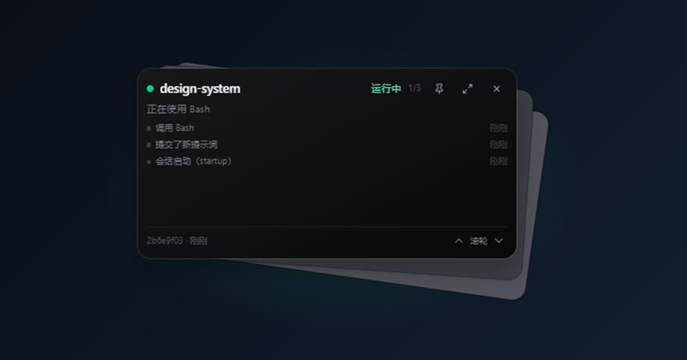
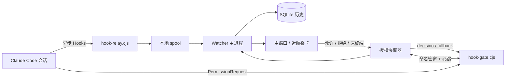

# Deckgate



> **多个 Claude Code 会话，一张会呼吸的小卡片。**
>
> 本地运行 · 不接管终端 · 只在需要你的时候出现。

Windows 10/11 x64 · Electron 45 · Local-first · MIT

---

## 为什么不是又一个通知器

同时开 4 个 Claude Code 终端时，真正让人分心的不是“任务结束”，而是**权限确认**。

通知工具会告诉你“某个会话在等你”，然后你还是得在窗口里找到那个终端，切过去，回答提示。仪表盘会把所有信息铺开，但授权仍然发生在终端里。

Deckgate 做的是另一件事：把 **PermissionRequest 变成一次本地交接**。所有会话集中在一张小卡片里；需要授权时，卡片上直接出现“允许 / 拒绝 / 回原终端”。应用没运行、进程卡死或你选择回退时，请求会**自动交还终端**，不改变 Claude Code 自己的权限规则。

它不是一个更漂亮的终端，也不是一个云控制台。它是终端旁边的一层安静的本地观察窗。

---

## 它长什么样

- **一张卡片**：项目、状态、当前工具、最近事件、会话短 ID。
- **多任务叠卡**：右下角会露出后两张卡片；当前卡片是最上面那张。
- **滚轮切换**：在卡片里滚动滚轮切换任务，带模糊、旋转和叠卡回弹动画。
- **就地授权**：需要你处理时，工具名、参数摘要、倒计时和“允许 / 拒绝 / 原终端”按钮直接出现在卡片里。
- **托盘常驻**：关闭窗口只隐藏；托盘图标可以显示待处理数量、置顶、切迷你条、停止自动授权或退出。
- **历史可查**：SQLite 记录会话、事件、通知和设置，按天保留，可清空。

> 迷你窗口是完全透明的：屏幕上没有窗口边框，只看到卡片和它后面的叠卡。

---

## 三个设计原则

1. **终端始终是最终权威。**
   门控 Hook 连接不到应用、心跳超过约 6 秒没有更新、应用退出或你点击“原终端”时，请求会放回原终端。应用只是可选的加速通道，不是单点故障。

2. **本地优先。**
   没有账号、没有云端、没有网络请求。会话状态、授权令牌、SQLite 数据库都只在本机。

3. **小到可以一直开着。**
   默认是 440×700 的紧凑窗口，可以收成约 340×170 的透明叠卡迷你条。它不是用来“管理一切”的大屏，而是用来少切几次窗口。

---

## 它如何工作



- **异步链路**：SessionStart、UserPromptSubmit、PreToolUse、PostToolUse、Notification、Stop 等事件由 `hook-relay.cjs` 写入本地 spool，应用收到后更新状态机。
- **同步门控**：`PermissionRequest` 由 `hook-gate.cjs` 通过当前用户的命名管道连接到应用，等待卡片上的决定；同时每秒发送心跳。
- **故障回退**：门控连接失败、心跳超时（默认 6 秒）、应用退出或请求超时（默认 600 秒）时，Hook 返回“原终端”，不阻塞 Claude Code。
- **本地持久化**：会话、事件摘要、通知和设置写入 SQLite；工具参数全文只在内存中展示，不写库。

只有带本应用标记的 Hooks 会被安装或卸载；安装前会备份用户设置。

---

## 功能一览

| 能力 | 说明 |
|---|---|
| 多会话状态 | 运行中 / 等待授权 / 等待输入 / 已完成 / 失败 / 已停止 / 未知 / 已断开 |
| 进程识别 | 结合 `~/.claude/sessions`、PID 和进程存活探测识别异常退出 |
| 事件时间线 | 当前工具、错误摘要、最近活动、最近事件 |
| 应用内授权 | 可选，默认关闭；普通工具请求可在卡片上允许或拒绝 |
| 自动授权 | 可选，高风险，默认关闭；按项目或所有项目生效，带工具/命令黑名单 |
| 安全看门狗 | 应用空闲不会误回退；进程卡死约 6 秒才回退终端 |
| 通知与声音 | Windows 原生通知、四类 Web Audio 提示音、冷却时间 |
| 托盘 | 待处理数量、显示/隐藏、置顶、迷你条、停止自动授权、退出 |
| 数据管理 | SQLite 历史、保留天数、清除历史、彻底卸载清理 |
| 隐私 | 不联网、不存提示词、不存工具参数全文、不存工具输出 |

---

## 快速开始

### 1. 安装

从本仓库的 **Releases** 页面下载最新的 `Deckgate-<version>-Setup.exe`，或从源码构建（见下文）。

安装包未签名，Windows SmartScreen 可能提示；选择“更多信息 → 仍要运行”。

### 2. 安装 Hooks

启动应用，点击右上角的“安装 Hooks”，确认原生对话框。

Hooks 写入用户级设置：

```text
%USERPROFILE%\.claude\settings.json
```

安装前会备份到：

```text
%APPDATA%\Deckgate\backups
```

### 3. 重启已有会话

Hooks 在会话启动时加载。安装前已经打开的 Claude Code 会话需要重启，之后才会产生事件。

### 4. 收起成迷你条

在窗口右上角点击“迷你条”按钮，或从托盘勾选“迷你条”。

---

## 应用内授权（可选，默认关闭）

开启后：

1. Claude Code 发出普通工具权限请求。
2. 迷你卡片或主窗口弹出授权卡片。
3. 你选择“允许”或“拒绝”；Claude Code 继续执行或收到拒绝。
4. 点击“原终端”、请求超时、应用退出或门控心跳中断时，请求回到原终端。
5. `AskUserQuestion` 不会应用内回答，始终回退终端。

默认等待上限是 10 分钟。应用只是空闲（你没有操作）不会触发回退；只有应用卡死或心跳中断才会。

### 自动授权（高风险，默认关闭）

这是一个显式选择的高风险模式：

- 打开总开关后，默认只对勾选项目自动允许普通工具权限；也可以开启“所有项目”。
- 默认不再因为 `Write`、`Edit`、`NotebookEdit` 或 `;`、`&&`、`||`、`|`、`>`、`<`、多行命令而拦截。
- 默认黑名单保留破坏性片段：`rm -rf`、`remove-item`、`del /f`、`del /s`、`rd /s`、`rmdir /s`、`format`、`diskpart`、`shutdown`、`reg delete`、`reg add`、`takeown`、`icacls`、`git reset --hard`、`git clean -fd`、`invoke-expression`、`set-executionpolicy` 等，可在设置中编辑。
- 未勾选项目、命中黑名单或 `AskUserQuestion` 仍然走手动卡片或原终端。
- 总开关关闭时，项目选择、所有项目、黑名单控件都会被禁用，只保存配置、不生效。
- “恢复默认值”会清空项目选择、关闭所有项目、重置两份黑名单，但不会关闭总开关。
- 托盘菜单提供“停止自动授权（立即）”。
- **不会修改** `~/.claude/settings.json` 中的权限规则，也不会添加“总是允许”条目；但匹配的请求确实会绕过 Claude Code 的权限确认。

黑名单是安全网，不是命令沙箱。清空它或在所有项目上开启自动授权，风险由你承担。

---

## 隐私与数据

本应用不发送任何网络请求。

SQLite 数据库：

```text
%APPDATA%\Deckgate\watcher.db
```

窗口状态与设置：

```text
%APPDATA%\Deckgate\settings.json
%APPDATA%\Deckgate\window-state.json
```

本地辅助数据：

```text
%LOCALAPPDATA%\Deckgate\spool
%LOCALAPPDATA%\Deckgate\approval-token.txt
%LOCALAPPDATA%\Deckgate\diagnose.json
```

**会保存**：会话 ID、工作目录、项目名、状态、时间戳、工具名、错误摘要、事件摘要、通知标题和正文。

**不会保存**：用户提示词、工具参数全文（包括命令）、工具输出、助手回复全文、任何凭据或 Token。

授权请求中的命令内容只在内存中展示；自动授权事件只记录工具名。

真正卸载应用（不是升级）时，卸载程序会尝试移除本应用 Hooks，并删除上述 `%APPDATA%\Deckgate` 与 `%LOCALAPPDATA%\Deckgate` 数据；升级安装会保留数据和 Hooks。

---

## 构建与测试

要求：Node.js 22.12+，Windows 10/11 x64。

```bash
npm install
npm run dev        # 开发模式
npm test           # 61 个单元/集成测试
npm run typecheck  # TypeScript 检查
npm run build      # 构建 main / preload / renderer
npm run dist       # 生成 Windows NSIS 安装包
```

构建产物：

```text
release\Deckgate-<version>-Setup.exe
```

打包会生成图标、把本机 `node.exe` 放入 `resources/runtime`，然后调用 electron-builder。安装包未签名；正式分发前建议配置代码签名证书。

> 如果网络无法直接访问 GitHub Release 下载 Electron 二进制，可以保留 `.npmrc` 中的 npmmirror 镜像；允许直连时可删除该配置。

---

## 项目结构

```text
src/main/           Electron 主进程：Hooks、状态机、进程、通知、托盘、SQLite、IPC
src/preload/        contextBridge 受限 API
src/renderer/       React 主窗口、透明叠卡迷你条、设置、授权卡片
src/shared/         共享类型、zod schema、IPC 协议
resources/hooks/    hook-relay.cjs（异步监控）与 hook-gate.cjs（同步授权门控）
scripts/            Hook 安装/卸载/诊断、图标、运行时与打包脚本
tests/              单元与集成测试
docs/               阶段一技术验证与设计文档
```

---

## 状态与已知限制

这是一个面向真实日常使用的实验性工具，不是官方 Claude Code 功能。

- 仅支持 **Windows 10/11 x64**。
- Hooks 在会话启动时快照，安装后需要重启已有会话。
- 无头 `claude -p` 模式下的权限请求会被 Claude Code 直接拒绝，不触发 `PermissionRequest`。
- `Stop` 只代表回合结束，不代表进程退出；`SessionEnd` 也不代表失败。
- 无法可靠识别原终端窗口或标签页，因此不提供自动聚焦；请看详情页提示手动返回。
- 进程识别依赖 `~/.claude/sessions` 的内部格式；格式变化时会降级为未知状态，而不是猜测。
- `AskUserQuestion` 始终回退终端，应用内只提醒。
- Windows 通知可能被专注助手或系统通知设置拦截。
- 安装包未签名，可能触发 SmartScreen。

---

## 参与贡献

欢迎 issue 和 PR。提交前请运行：

```bash
npm test
npm run typecheck
```

安全问题请按 [SECURITY.md](SECURITY.md) 私下报告，不要公开漏洞细节。

---

## English

**Deckgate** is a local-only Windows companion for people who run many Claude Code CLI sessions at once.

It is not another notification bot. It turns `PermissionRequest` into a local handoff: every session is visible in one small stacked-card window, and permission prompts can be allowed or denied right there. If the app is closed, frozen, or you choose “terminal”, the hook falls back to the original terminal. It never edits Claude Code’s permission rules.

Highlights: transparent stacked-card mini mode with wheel switching, inline approvals, per-project auto-approval with blacklists and a tray kill switch, SQLite history, and no network access. Defaults are conservative: approval and auto-approval are off.

Built with Electron, React, TypeScript, and Tailwind CSS. Tested on Windows 11 x64 with Claude Code 2.1.126.

---

## License

MIT. See [LICENSE](LICENSE).
